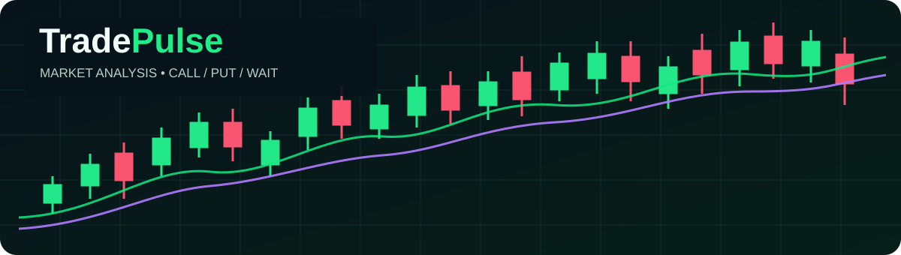

<div align="center">



# TradePulse

**Análise técnica sobre dados reais da IQ Option PRACTICE · sinais CALL / PUT / WAIT explicáveis**

  

</div>

> TradePulse é um **assistente de análise**. Ele **nunca executa ordens**, lê **somente a conta PRACTICE**
> e não promete rentabilidade nem taxa de acerto. Toda metodologia de entrada e avaliação ainda é
> **provisória e experimental** (ver [docs/SIGNAL_LIFECYCLE.md](docs/SIGNAL_LIFECYCLE.md)).

## Estado atual

Blocos **A.1 + A.2 (coleta confiável e sincronizada)** implementados e testados automaticamente.
A **validação com a IQ Option real ainda não foi feita** (depende das credenciais PRACTICE do
proprietário — procedimento em [docs/TESTING.md](docs/TESTING.md#validação-real-pelo-proprietário)).
Detalhes em [docs/PROJECT_STATUS.md](docs/PROJECT_STATUS.md) e no relatório
[docs/reports/A1-A2-RELATORIO.md](docs/reports/A1-A2-RELATORIO.md).

## Arquitetura em uma linha

```
React/Vite (PWA) ──HTTP GET──▶ Express (127.0.0.1:3001) ──JSON-lines──▶ worker Python persistente ──websocket──▶ IQ Option PRACTICE
                                 ├ agendador por fechamento de vela        └ 1 sessão · cache de candles · estratégias M1/M5/M15
                                 └ publicação + validade calculada na leitura
```

Detalhes: [docs/ARCHITECTURE.md](docs/ARCHITECTURE.md).

## Estratégias

| Timeframe | Estratégia | Estado |
|---|---|---|
| M1 | EMA 9/21 · RSI 14 · ADX 14 · ATR 14 | Implementada; regras preservadas; sem validação estatística |
| M5 | EMA 200 · RSI 14 · MACD 12/26/9 + contexto M15 (ADX/ATR como filtros, pendente de aprovação) | **Experimental**, somente GBPUSD-OTC, ação final sempre WAIT |

Regras completas: [docs/TRADING_STRATEGIES.md](docs/TRADING_STRATEGIES.md).

## Executar localmente (Windows / PowerShell)

Requisitos: Node.js 24 (testado com 24.21), Python 3.14 (testado com 3.14.8), Git.

```powershell
git clone https://github.com/VitorDutraMelo/tradepulse.git
cd tradepulse
cd backend;  npm install; cd ..
cd frontend; npm install; cd ..
cd quant-engine
py -3.14 -m venv .venv
.\.venv\Scripts\python.exe -m pip install -e ".[dev]"
cd ..
```

Credenciais PRACTICE **somente no terminal do backend** (nunca no frontend, no Git ou em capturas):

```powershell
cd backend
$env:IQ_OPTION_DEMO_EMAIL = "seu-email"
$env:IQ_OPTION_DEMO_PASSWORD = "sua-senha"
npm run dev
```

Em outro terminal:

```powershell
cd frontend
npm run dev
```

Abra `http://127.0.0.1:5173`. O backend aceita conexões **apenas de loopback** (127.0.0.1).

## Testes

```powershell
cd quant-engine; .\.venv\Scripts\python.exe -m pytest; .\.venv\Scripts\python.exe -m ruff check .
cd ..\backend;  npm test; npm run typecheck; npm run build
cd ..\frontend; npm run typecheck; npm run build
```

Resultados atuais e limites da validação: [docs/TESTING.md](docs/TESTING.md).

## Documentação

| Documento | Conteúdo |
|---|---|
| [CHANGELOG.md](CHANGELOG.md) | Histórico de mudanças |
| [docs/PROJECT_STATUS.md](docs/PROJECT_STATUS.md) | O que está implementado, testado, validado e bloqueado |
| [docs/ARCHITECTURE.md](docs/ARCHITECTURE.md) | Componentes e fluxo de dados |
| [docs/ROADMAP.md](docs/ROADMAP.md) | Blocos e ordem de execução |
| [docs/TRADING_STRATEGIES.md](docs/TRADING_STRATEGIES.md) | Regras M1, M5 e M15 |
| [docs/DATA_INTEGRITY.md](docs/DATA_INTEGRITY.md) | Velas fechadas, relógio, cache, atualidade |
| [docs/SIGNAL_LIFECYCLE.md](docs/SIGNAL_LIFECYCLE.md) | Entrada, expiração, tolerância e estados |
| [docs/API_CONTRACTS.md](docs/API_CONTRACTS.md) | Endpoints e contratos |
| [docs/TESTING.md](docs/TESTING.md) | Testes e validação real |
| [docs/SECURITY.md](docs/SECURITY.md) | PRACTICE, credenciais, rede, conta REAL |
| [docs/adr/](docs/adr/) | Decisões arquiteturais |
| [docs/audits/](docs/audits/) | Auditorias A.0 (referência histórica) |

## Risco

Indicadores técnicos não garantem lucro. Opções binárias podem ser restritas ou proibidas em algumas
jurisdições. A integração com a IQ Option é **não oficial** e pode parar de funcionar sem aviso.
