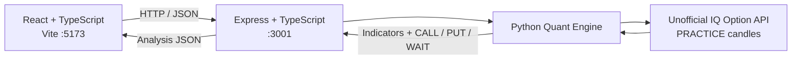

<div align="center">


# TradePulse

**IQ Option PRACTICE market analysis · Explainable CALL / PUT / WAIT signals**

  

    

</div>

## Overview

TradePulse is a local, read-only dashboard that retrieves candlestick data through an **unofficial IQ Option integration in PRACTICE mode** and turns it into explainable technical analysis. The frontend displays the selected OTC pair, the latest analysis, indicator values, reference times, and the original JSON response.

**Current scope:** technical research only. No orders are submitted, no real account is used, and no profits or signal accuracy are guaranteed.

## Dashboard features

| Feature | Current behavior |
|---|---|
| Signal | **🟢 CALL**, **🔴 PUT**, or **⚪ WAIT** |
| Market | Select one of eight OTC symbols |
| Timeframe | `1m` |
| Candle request | `limit=120` |
| Refresh | Every 60 seconds or manually |
| Indicators | EMA 9, EMA 21, RSI 14, ADX 14, ATR 14 |
| Explanation | Reasons returned by the backend |
| Reference | Analysis, entry and expiration timestamps |
| API inspection | View the JSON response |
| Error handling | Show errors without inventing a signal |

> The eight symbols are **frontend choices**, not a live list of open markets. A selectable asset is not necessarily available from the provider at that moment.

### OTC symbols

`EURUSD-OTC` · `GBPUSD-OTC` · `USDJPY-OTC` · `EURJPY-OTC` · `EURGBP-OTC` · `AUDUSD-OTC` · `USDCAD-OTC` · `AUDCAD-OTC`

**Verified with returned PRACTICE candles:** `EURUSD-OTC` and `GBPUSD-OTC`. Other pairs require individual validation.

## Signal logic

| Signal | Conditions |
|---|---|
| **CALL** | EMA 9 above EMA 21, RSI within configured bullish range, ADX above configured minimum |
| **PUT** | EMA 9 below EMA 21, RSI within configured bearish range, ADX above configured minimum |
| **WAIT** | Required conditions are not aligned |

ATR 14 is returned as a volatility indicator; this does **not** establish that ATR currently filters signals. The exact thresholds live in the Python engine, not in this README.

## Architecture



```text
tradepulse/
├── backend/                 # Express API
├── frontend/                # React / Vite dashboard
│   ├── src/App.tsx
│   ├── src/api.ts
│   └── src/style.css
├── quant-engine/            # Python indicators and signal rules
├── docs/
│   └── images/
│       └── tradepulse-candles.svg
└── README.md
```

## REST API

**Backend:** `http://localhost:3001`

```http
GET /api/v1/health
GET /api/v1/iq-option/demo/market-analysis?symbol=GBPUSD-OTC&timeframe=1m&limit=120
```

Example PowerShell request:

```powershell
Invoke-RestMethod "http://localhost:3001/api/v1/iq-option/demo/market-analysis?symbol=GBPUSD-OTC&timeframe=1m&limit=120" | ConvertTo-Json -Depth 10
```

### Analysis response contract

```json
{
  "symbol": "GBPUSD-OTC",
  "timeframe": "1m",
  "source": "iq_option_demo",
  "accountMode": "PRACTICE",
  "analysisAt": "2026-11-08T14:00:00Z",
  "lastClosedCandle": {
    "openTime": "2026-11-08T13:59:00Z",
    "closeTime": "2026-11-08T14:00:00Z",
    "ageSeconds": 0
  },
  "indicators": {
    "ema9": 1.25,
    "ema21": 1.251,
    "rsi14": 42,
    "adx14": 26,
    "atr14": 0.0006
  },
  "action": "PUT",
  "reference": {
    "price": 1.2498,
    "entryTime": "2026-11-08T14:01:00Z",
    "expirationTime": "2026-11-08T14:02:00Z"
  },
  "reasons": ["Example bearish EMA, RSI and ADX conditions."],
  "disclaimer": "Technical reference only. No IQ Option order was sent."
}
```

*Illustrative payload: prices and timestamps above are not a verified live signal. A reference price is not a confirmed entry execution price.*

## Local setup (Windows / PowerShell)

### Requirements

- Git
- Node.js and npm
- Python with `venv` and `pip`
- Access to the required IQ Option PRACTICE data integration, subject to its terms and local restrictions

### 1. Clone and install

```powershell
git clone https://github.com/VitorDutraMelo/tradepulse.git
cd tradepulse

cd backend
npm install
cd ..\frontend
npm install
cd ..\quant-engine
py -m venv .venv
.\.venv\Scripts\Activate.ps1
python -m pip install --upgrade pip
python -m pip install -e .
cd ..
```

If PowerShell blocks venv activation, use a process-scoped policy change only if permitted by your machine's security policy:

```powershell
Set-ExecutionPolicy -Scope Process -ExecutionPolicy RemoteSigned
```

**Python note:** confirm additional dependencies and exact Python version requirements against `quant-engine` project files. The editable installation above is the expected starting point, not a guarantee that all external integration dependencies are available.

### 2. Configure environment safely

Copy `frontend/.env.example` to `frontend/.env.local` if needed, and use the existing API base URL setting from that example. The frontend must use `http://localhost:3001`.

**IQ Option PRACTICE credentials must be provided only through the backend/quant-engine's existing terminal environment-variable flow.** Consult the implementation for the exact variable names. Never paste credentials into frontend code, Git, README, screenshots, or logs. Do not commit any `.env.local` file.

### 3. Start the backend

In a new PowerShell terminal:

```powershell
cd tradepulse\backend
npm run dev
```

### 4. Start the frontend

In another terminal:

```powershell
cd tradepulse\frontend
npm run dev
```

Open **http://localhost:5173** (not `127.0.0.1:5173`, due to the configured CORS origin).

### 5. Verify

```powershell
Invoke-RestMethod "http://localhost:3001/api/v1/health"
```

Select an OTC asset in the dashboard and request analysis. If the provider cannot return valid data, the UI should show an error rather than a fabricated signal.

## Tests

```powershell
cd backend
npm test
npm run build

cd ..\frontend
npm run build
```

**Last reported local verification (8 Nov 2026):** backend **27/27 tests passed** and frontend Vite build succeeded. This is a local checkpoint, not a CI badge or a claim of validated trading performance.

## Roadmap

- [x] React + TypeScript dashboard
- [x] Express API and Python analysis integration
- [x] PRACTICE candle-data retrieval for tested OTC pairs
- [x] EMA 9/21, RSI 14, ADX 14, ATR 14
- [x] Explainable CALL / PUT / WAIT API responses
- [x] Local dashboard with asset selection and refresh
- [ ] Validate all selectable symbols and provider reliability
- [ ] Reliable entry/expiry outcome recording and historical evaluation
- [ ] Reproducible backtests and out-of-sample validation
- [ ] Documented, reproducible setup on another developer's computer

## Security and risk

- **Read-only:** no trading-order execution.
- **PRACTICE only:** no real-money account integration.
- **Secrets:** credentials belong in local environment variables, never in Git.
- **Unofficial integration:** availability, reliability and authorization must be independently evaluated.
- **Financial risk:** technical indicators do not guarantee profit. Binary options may be restricted or prohibited for retail users in some jurisdictions, including the UK.

---

<div align="center">

**TradePulse — Build signals you can inspect, not promises you cannot verify.**

</div>
