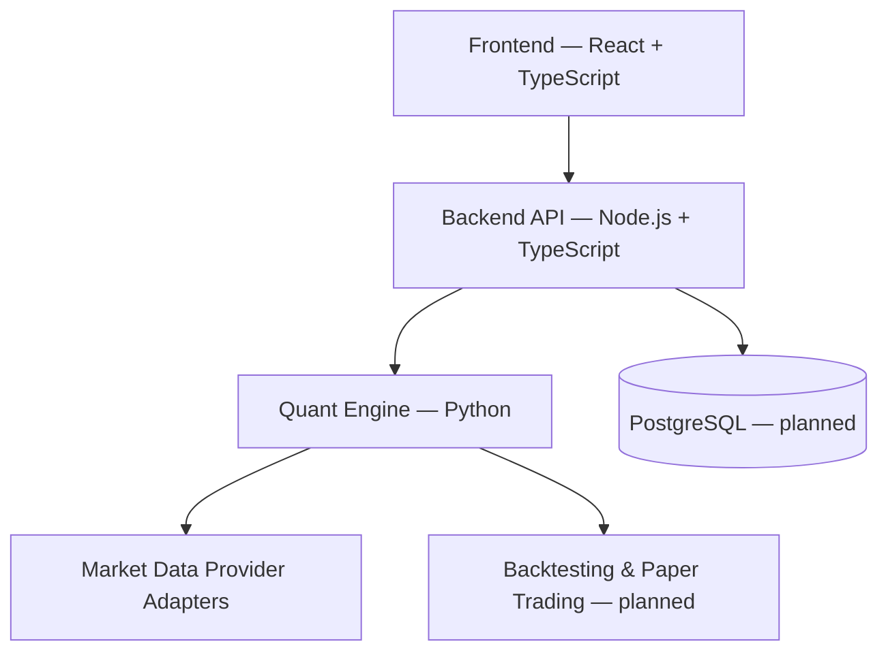

# TradePulse

**A modular market-analysis platform for technical signals, strategy research, and backtesting.**

TradePulse is an in-development full-stack project designed to turn market data into explainable technical analysis. Its first product focus is **signal research for markets available on IQ Option**, with an architecture that can support additional data providers and markets over time.

> **Project status:** Early development. The frontend prototype exists; the Python quantitative engine is being set up. Market-data integrations, validated signals, backtesting, and live trading features are **not yet implemented or verified**.

## Vision

TradePulse aims to help users explore trading setups through transparent, testable analysis rather than opaque “guaranteed win” predictions.

The platform is being designed to:

- Analyze normalized OHLCV candlestick data.
- Calculate technical indicators and recognize candlestick patterns.
- Evaluate configurable strategies and generate **LONG**, **SHORT**, or **NEUTRAL** signals.
- Explain which conditions contributed to each signal.
- Run historical backtests and report strategy performance.
- Support paper trading and, eventually, alerts and live monitoring.
- Keep market-data providers separate from the analysis engine.

**Important:** A technical signal score measures agreement with a strategy's rules; it is **not** a probability of profit. Any reported performance must be supported by appropriately designed tests.

## Architecture



| Component | Planned stack | Responsibility |
| --- | --- | --- |
| `frontend/` | React, TypeScript | Dashboard, charts, signals, and strategy views |
| `backend/` | Node.js, TypeScript, Express | Product API, users, persistence, history, and alerts |
| `quant-engine/` | Python, pandas, NumPy, pytest | Data normalization, indicators, patterns, strategies, signals, and backtesting |
| Database | PostgreSQL, Prisma | Application and research data persistence |
| `docs/` | Markdown | Architecture and strategy documentation |

The services will communicate through explicit, versioned data contracts. The Node.js API will serve the frontend; the Python engine will handle quantitative calculations.

## Planned analysis pipeline

```text
Market data
    ↓
OHLCV normalization
    ↓
Market context + technical indicators
    ↓
Candlestick pattern detection
    ↓
Configurable strategy rules
    ↓
Signal: LONG / SHORT / NEUTRAL
    ↓
Risk / outcome model
    ↓
Backtesting, metrics, and paper trading
    ↓
API and dashboard
```

For binary or digital options, the presentation layer may map **LONG → CALL** and **SHORT → PUT**. Outcome evaluation must account for the relevant expiry and payout model; it must not be confused with stop-loss/take-profit trading.

## Development roadmap

- [x] Define the initial product vision and modular architecture.
- [x] Build an initial frontend prototype using demonstration data.
- [x] Organize the repository into frontend, backend, and quantitative-engine areas.
- [ ] Finalize Python environment and project tooling.
- [ ] Implement normalized candle models and a mock market-data provider.
- [ ] Implement and test technical indicators and candlestick patterns.
- [ ] Implement configurable strategy rules and explainable signals.
- [ ] Build reproducible historical backtests and performance metrics.
- [ ] Validate out-of-sample results and introduce paper trading.
- [ ] Build and connect the Node.js API to the frontend.
- [ ] Evaluate an authorized IQ Option market-data integration.
- [ ] Add live monitoring, alerts, and other providers as appropriate.

Roadmap items are goals, not claims of completed functionality.

## Repository structure

```text
tradepulse/
├── backend/             # Node.js API (planned)
├── frontend/            # UI prototype
├── quant-engine/        # Python quantitative analysis
│   ├── app/
│   └── tests/
├── docs/                # Architecture and strategy notes
├── .gitignore
└── README.md
```

> The structure above reflects the intended layout; individual modules may evolve as implementation progresses.

## Engineering principles

- **Evidence before claims:** assess strategies with backtests, out-of-sample evaluation, and paper trading.
- **No look-ahead bias:** decisions must use only data available at the time.
- **Explainable signals:** preserve the rules and evidence behind each result.
- **Provider independence:** avoid hard-coding the analysis engine to a broker.
- **Testable components:** isolate indicators, strategies, and outcome calculations.
- **Incremental delivery:** ship small, verified improvements before expanding scope.
- **Secure by default:** keep credentials out of source control and use environment variables.

## Getting started

The project is still in its foundation stage, so a complete installation and run guide is not available yet. Setup instructions will be added once the development environment and initial services are verified.

## IQ Option integration and scope

IQ Option is the **initial platform focus**, not a dependency of the core strategy engine. Any integration will be evaluated for technical reliability, authorization, terms of service, and applicable legal requirements.

**TradePulse does not currently place real-money trades.** Automated order execution is not part of the initial implementation and is not promised as a future feature.

## Risk disclaimer

TradePulse is a software engineering and market-research project, **not financial advice**. Technical analysis and backtesting cannot guarantee future performance. Trading involves risk, and binary options may be restricted or prohibited for retail customers in certain jurisdictions, including the United Kingdom.

## Project status

**Under active development.** This repository documents the implementation process, architectural decisions, testing practices, and future capabilities as they are built.

---

*Built to explore the intersection of backend engineering, quantitative analysis, and full-stack product development.*
